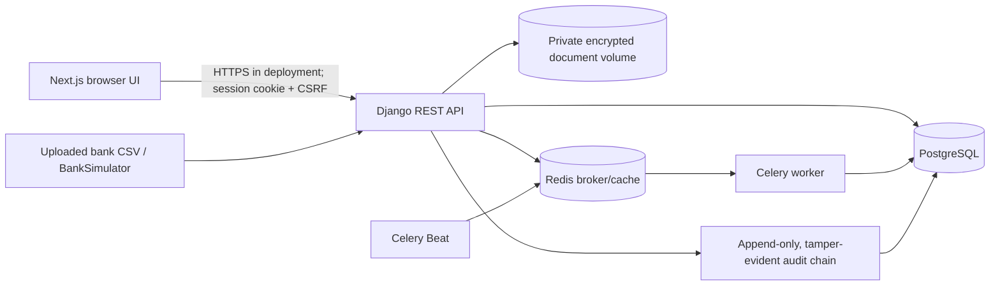

# FDR Kavach Website

Security-first Fixed Deposit Receipt and security deposit management website for the AICTE Regulation Bureau. Product principle: **Protected records. Verified evidence. Controlled release.** This project is a hackathon prototype. It does not claim to be an official AICTE system and does not use AI or blockchain.

## Architecture



The browser never stores authentication tokens in local storage. Django sessions, CSRF checks, role permissions, institution scoping, and object checks are enforced by the API. Public resource URLs use UUIDs; relational database rows retain internal integer surrogate keys.

## Database design

- `User` has one of six roles, an optional institution foreign key, lockout state, and encrypted TOTP seed. `Institution` owns its FDRs.
- `FDR` belongs to an institution and can point to an earlier FDR through `renewal_of`. `FDRVersion` stores dated snapshots.
- `FDRDocument` stores private, randomly named encrypted files with SHA-256, uploader, and extraction results. `FDREvidence` separately stores `DECLARED`, `DOCUMENT_OBSERVED`, and `BANK_CONFIRMED` values.
- `BankBatch` owns parsed `BankBatchRow` records; `ReconciliationResult` can link a row to an FDR and a classification. Cases, alerts, and escalation policies track exceptions.
- `CoverageRuleSet` stores amount, source, effective date, approving authority, tolerance, and release checklist. `CoverageDay` records per-institution daily calculations against a rule set.
- `ReleaseRequest` records requester, reviewer, approver, checklist and discharge evidence. Material changes invalidate active approvals.
- `AuditEvent` is append-only through the application and forms a hash chain. `ImportJob` persists legacy import validation results.

## Website interface

The responsive light-theme portal uses deep navy (`#1F497D`), keyboard-visible focus styles, and an optional dark theme. After authentication, role-aware navigation opens separate views for the dashboard, FDR repository, Evidence Passport, submission, bank reconciliation, Case Centre, coverage timeline, release readiness, bitemporal history, audit verification, Rule Sets, and impact reporting. Staff sign-in includes TOTP enrollment and verification. Loading, error, empty, and confirmation states are provided for the corresponding operations. A **Simulated bank data** banner is compiled into the site when `DEMO_MODE=true`.

## Pinned stack

Python 3.12, Django 5.2.17, DRF 3.18.2, PostgreSQL 16.4, Celery 5.4.0, Redis 7.4.1, Next.js 15.5.28, React 18.3.1, TypeScript 5.7.3, and Tailwind 3.4.19. Python dependencies are pinned in `backend/requirements.txt`; frontend dependencies in `frontend/package-lock.json`. Docker images use pinned versions.

## Local setup

Prerequisites: Docker Desktop with Compose, Git, and a browser.

When running Django directly for UI work with `DJANGO_DEBUG=1`, login throttling uses a process-local cache unless `DJANGO_USE_REDIS_CACHE=1` is set. Docker Compose explicitly uses the Redis service.

1. Copy `.env.example` to `.env`; set unique random values for `DJANGO_SECRET_KEY`, `MFA_ENCRYPTION_KEY`, `DOCUMENT_ENCRYPTION_KEY`, and database credentials. The example values are development placeholders only.
2. Run `make dev` (or `docker compose up --build`). The app is at [http://localhost:3000](http://localhost:3000) and API at [http://localhost:8000/api/](http://localhost:8000/api/).
3. Create the first administrator with `docker compose exec api python manage.py createsuperuser`, then assign `ADMIN` role in Django admin. Add institution users and associate each with an institution. Staff enroll TOTP during first login.
4. To enable demo data, set `DEMO_MODE=true` in `.env` and rebuild with `make dev`. Then run `make seed`. The command refuses to run unless both `DJANGO_DEBUG=1` and `DEMO_MODE=true`; generated one-time demo credentials print only for accounts newly created by the command. The website displays a **Simulated bank data** banner in this mode.
5. `make test` runs backend tests and enforces at least 85% coverage for core domain modules. `make lint` runs Ruff; `make frontend-build` builds the UI.

Use `make down` to stop the local stack. Persistent PostgreSQL and encrypted file volumes remain until deliberately removed.

## Demo walkthrough

1. Start with `make dev`, then in another terminal run `make seed`. Sign in as `demo-demo-001` to exercise institution-scoped FDR access; use the printed `demo-senior`, `demo-reviewer`, and `demo-approver` credentials for separate staff actions.
2. Open the FDR list and reconciliation views. The seeded bank batch deliberately includes amount and date discrepancies, an unmapped number, and records missing from the batch. The API runs these through `BankSimulator` and stores cases and audit events.
3. Submit a new FDR and upload a PDF. Review extracted values, correct them, and submit. Uploading a supporting document never creates bank confirmation; only a processed bank row can create `BANK_CONFIRMED` evidence.
4. Inspect coverage for a chosen date range. Seeded values are clearly marked **DEMO RULE** and are not official AICTE amounts or rules. Create a renewal record linked to a matured FDR and inspect the timeline for uncovered days.
5. Change a verified field or supporting document and confirm re-verification is required. Request release as the maker; perform review and approval using different accounts. The requester cannot review/approve their own request, and reviewer and approver must differ.
6. Use the audit integrity screen or `GET /api/audit/verify` as ADMIN/AUDITOR. Tampering in a test database causes verification to fail.

### Simulated integrations

Bank verification is a local CSV `BankSimulator`, not a bank API connection. PDF extraction uses PyMuPDF text extraction and does not OCR scanned images. Email/SMS alerts are persisted in the application but no external delivery provider is connected. Demo institutions, users, bank rows, and all seeded financial rule values are synthetic.

## Implemented features

- **Phase 1:** session login/logout/rotation, CSRF, Argon2, lockout/throttling, role checks, staff TOTP MFA, security headers, and append-only, tamper-evident audit verification.
- **Phase 2:** institution-scoped UUID-addressed FDRs, versioning, private encrypted uploads, SHA-256, bounded PDF extraction, separate evidence types, and re-verification after material changes.
- **Phase 3:** duplicate detection, bank CSV simulator and reconciliation classifications, case ownership/severity/due dates, persisted alerts, Celery reminders/escalations.
- **Phase 4:** daily coverage against configurable rule sets, timeline/shortfall tracking, release checklist and maker-checker workflow.
- **Phase 5:** dashboard, prioritization, temporal record views, audit-logged CSV/PDF export, and legacy CSV/XLSX dry-run/import.
- **Phase 6:** security acceptance tests, core coverage gate, Bandit/Ruff/pip-audit/npm audit and Gitleaks CI configuration; production secret and HTTPS checks.
- **Phase 7:** this setup/architecture/demo documentation, debug-only demo seed command, and `SECURITY.md` threat model.

## Configuration and deployment security

`DJANGO_DEBUG` defaults to `0`. Production startup rejects missing/default/short Django secrets, missing encryption keys, insecure cookies, disabled SSL redirect, and non-HTTPS browser/CSRF origins. Set stable key material in the deployment secret manager; rotating encryption keys requires an explicit re-encryption migration. Use TLS at the proxy and configure allowed hosts, origins, and trusted proxy headers for the actual deployment.

Uploaded PDFs and bank CSVs use random server-generated filenames, encrypted private storage, extension/size/signature or parser validation, and authenticated downloads. Uploaded documents are evidence of what the institution submitted; they are never treated as bank confirmation. TOTP seeds are encrypted in the database. No dedicated beneficiary/account-number fields are currently modeled; future fields must use encrypted field storage and must not be logged.

Audit events reject application-level updates/deletes. The hash chain is tamper-evident against ordinary application changes; a privileged database operator could alter the entire chain. Production should export signed checkpoints to independent controlled storage.

## Checks

```powershell
make dev
make seed
make test
make lint
make frontend-build
```

CI also runs Bandit, pip-audit, npm audit, and Gitleaks. Local checks may require the matching tools installed. See [`SECURITY.md`](SECURITY.md) for the threat model and residual risks.
